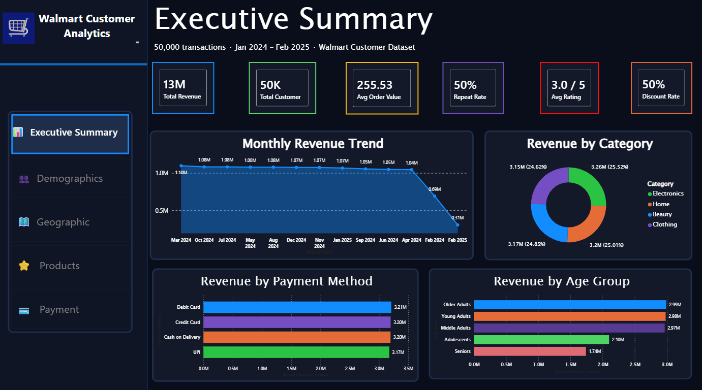
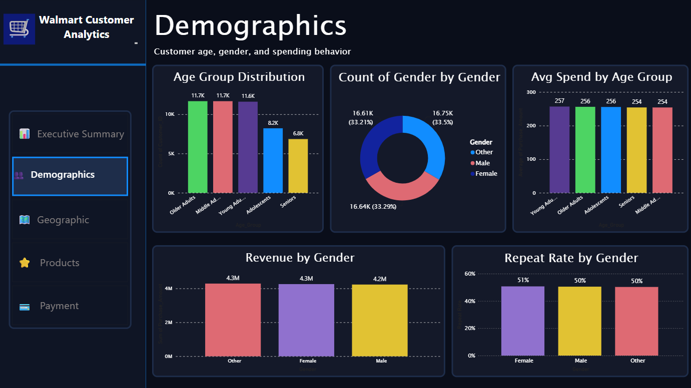
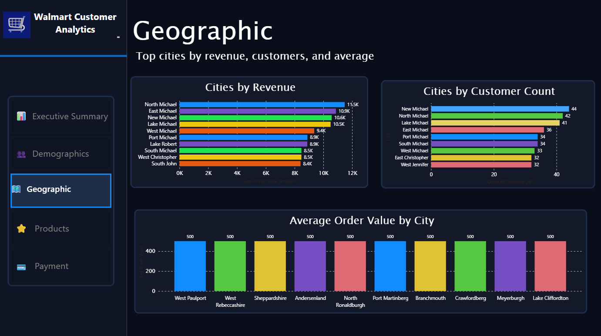
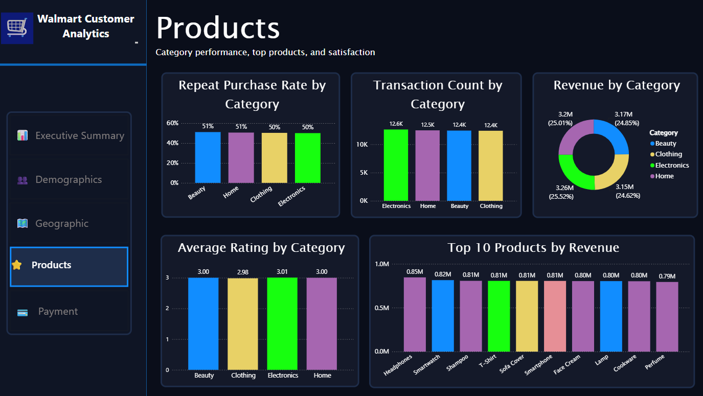
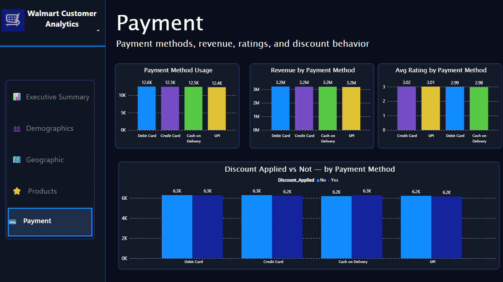

# 🛒 Walmart Customer Analytics Dashboard — Power BI

A comprehensive customer analytics dashboard built in Power BI to evaluate shopping behaviour
across 50,000 Walmart transactions spanning January 2024 to February 2025 — analysing revenue
patterns, demographic segments, geographic performance, product mix, and payment behaviour
through interactive visuals and DAX-powered KPI cards.


---

## 🧠 Project Summary

This case study demonstrates:

- **Strong analytical thinking** — translating 50K retail transactions into layered business insights across five dashboard sections
- **Practical DAX & data modeling** — explicit measures, star schema, calculated columns, and a marked date table for time-intelligence
- **Business decision-making** — prioritised recommendations tied directly to measurable revenue, loyalty, and satisfaction outcomes

---

## 🎯 Business Problem

Retail businesses generate vast transactional data but often lack the consolidated visibility
needed to act on it. Without segment-level and product-level breakdowns, resource allocation
and marketing decisions rely on intuition rather than evidence.

| Question | Answer Provided |
|---|---|
| Which product categories drive the most revenue and repeat purchases? | Category revenue share, repeat rate, and top 10 product breakdown |
| Which customer demographics and cities represent the highest-value segments? | Age group, gender, and city-level revenue and AOV analysis |
| How do payment methods correlate with spend, ratings, and discount uptake? | Payment channel usage, revenue, satisfaction, and discount distribution |

---

## 📁 Dataset Overview

**Source:** [Walmart Customer Purchase Behavior Dataset — Kaggle](https://www.kaggle.com/datasets/logiccraftbyhimanshi/walmart-customer-purchase-behavior-dataset)

Two tables joined via a date key:

| Table | Key Columns | Description |
|---|---|---|
| `Walmart_customer_purchases` | Customer_ID, Product_Name, Category, Purchase_Amount, Rating, Payment_Method, Discount_Applied, City, Age_Group, Gender, Repeat_Customer | Primary fact table — 50,000 transactions with customer attributes and purchase details |
| `DimDate` | Date, MonthYear, Month, Year | Date dimension enabling time-series monthly trend analysis across Jan 2024 – Feb 2025 |

### Table 1: Walmart_customer_purchases *(Fact Table — 50,000 rows)*

| Column | Data Type | Description |
|---|---|---|
| Customer_ID | Text / VARCHAR | Unique identifier assigned to each customer |
| Product_Name | Text / VARCHAR | Name of the purchased product (e.g. Smartwatch, Shampoo, Laptop) |
| Category | Text / VARCHAR | Product category grouping — Electronics, Home, Beauty, or Clothing |
| Purchase_Amount | Decimal / FLOAT | Total transaction value in USD for that purchase |
| Rating | Integer / INT | Customer satisfaction score post-purchase, scale of 1–5 |
| Payment_Method | Text / VARCHAR | Checkout channel used — Debit Card, Credit Card, Cash on Delivery, or UPI |
| Discount_Applied | Boolean / BIT | Whether a discount was applied to the transaction — Yes or No |
| City | Text / VARCHAR | City where the purchase was made or customer is located |
| Age_Group | Text / VARCHAR | Customer age segment — Adolescents, Young Adults, Middle Adults, Older Adults, or Seniors |
| Gender | Text / VARCHAR | Customer gender identity — Male, Female, or Other |
| Repeat_Customer | Boolean / BIT | Whether the customer has made more than one purchase — Yes or No |

### Table 2: DimDate *(Date Dimension Table)*

| Column | Data Type | Description |
|---|---|---|
| Date | Date / DATE | Full calendar date of the transaction (e.g. 2024-01-15) |
| MonthYear | Text / VARCHAR | Month and year label used for chart axis display (e.g. Jan 2024) |
| Month | Integer / INT | Numeric month value for sorting and filtering (1–12) |
| Year | Integer / INT | Calendar year of the transaction — 2024 or 2025 |

---

## 🧱 Data Modeling Approach

- **Star Schema** — Walmart_customer_purchases fact table linked to DimDate via a calculated date key
- **Calculated Columns** — Age_Group bins (18–25, 26–35, 36–45, 46–55, 55+) derived from customer age; binary Repeat_Customer flag
- **Explicit DAX Measures** — Total Revenue, Avg Order Value, Repeat Rate, Discount Rate, Avg Rating, Total Transactions — all ensuring correct filter context
- **Date Table** — DimDate marked as official date table, enabling time-intelligence functions across the MonthYear hierarchy

---

## 📊 End-to-End Dashboard KPIs

| 13M | 50K | $255.53 | ~50% | 3.0 / 5 | 50% |
|---|---|---|---|---|---|
| Total Revenue | Total Customers | Avg Order Value | Repeat Customer Rate | Avg Product Rating | Discount Rate |

---

## 📄 Dashboard Structure

### 🖥️ Page 1 — Executive Summary
**Objective:** High-level KPIs, revenue trends, and cross-dimensional breakdowns.

| Visual | Description |
|---|---|
| Total Revenue (KPI Card) | $13M total revenue across 50,000 transactions — the headline performance figure |
| Total Customers (KPI Card) | 50K unique customers sets the scale of the customer base |
| Avg Order Value (KPI Card) | $255.53 average spend per transaction — a key lever for revenue growth without volume increases |
| Repeat Rate (KPI Card) | 50% of customers made repeat purchases — indicates baseline retention health |
| Avg Rating (KPI Card) | 3.0 / 5 overall satisfaction score — flags a systemic quality or experience gap |
| Discount Rate (KPI Card) | 50% of transactions involved a discount — signals heavy promotional dependency |
| Monthly Revenue Trend (Line) | Revenue held flat near $1M/month from Mar 2024 through Jan 2025, then collapsed sharply in Feb 2025 — a critical anomaly requiring investigation |
| Revenue by Category (Donut) | Near-equal four-way split: Electronics 25.52%, Clothing 25.01%, Beauty 24.85%, Home 24.62% |
| Revenue by Payment Method (Bar) | Debit Card leads, followed closely by Credit Card, Cash on Delivery, and UPI |
| Revenue by Age Group (Bar) | Older Adults and Young Adults generate the highest revenue; Seniors contribute the least |

**Key Findings:**
1. Revenue was remarkably stable across the full period before a sharp drop in Feb 2025 — likely a data truncation or seasonal event requiring investigation
2. Category revenue is almost perfectly balanced across all four segments (~25% each), meaning no single category is a meaningful revenue risk
3. The 3.0/5 average rating and 50% discount rate together suggest price sensitivity may be masking underlying satisfaction issues

---

### 👥 Page 2 — Demographics
**Objective:** Customer age, gender, and spending behaviour — identifying which demographic segments drive volume, value, and loyalty.

| Visual | Description |
|---|---|
| Age Group Distribution (Bar) | Older Adults lead (~10.5K); Middle Adults and Young Adults (~10K each); Adolescents and Seniors trail |
| Count of Gender by Gender (Donut) | Near-equal three-way split: Female 33.5%, Male 33.29%, Other 33.21% |
| Avg Spend by Age Group (Bar) | Average order value is flat across all five cohorts (~$240–$270) — no age group spends meaningfully more per transaction |
| Revenue by Gender (Bar) | Total revenue is effectively equal across all three gender groups (~$4M each) |
| Repeat Rate by Gender (Bar) | Repeat rates near-identical: Female ~50%, Other ~49%, Male ~47% |

**Key Findings:**
1. Demographics are a non-differentiating dimension across almost every metric
2. Gender is a perfectly balanced three-way split in both customer count and revenue; repeat rates vary by less than 3 percentage points
3. Age group shows flat average spend across all cohorts despite Older and Middle Adults driving slightly higher transaction volumes
4. Behavioural or category-level signals will be far more productive levers for personalisation and retention than demographic segmentation alone

---

### 🗺️ Page 3 — Geographic
**Objective:** Top cities by revenue, customer count, and average order value — identifying volume-driven vs value-driven markets.

| Visual | Description |
|---|---|
| Cities by Revenue (Bar) | North Michael leads (~ $11.5K), followed by East Michael (~ $11K) and New Michael (~$10.5K) — the "Michael" city cluster dominates the top tier |
| Cities by Customer Count (Bar) | New Michael leads (~43 customers), followed by North Michael (~42) and Lake Michael (~38) — count ranking does not perfectly mirror revenue ranking |
| Average Order Value by City (Bar) | West Joseph leads at ~$322; all cities cluster tightly between $240–$290,indicating moderate variation in spending per order across locations. Higher-AOV cities do not necessarily align with the top revenue cities, suggesting differences in customer spending behavior rather than transaction volume alone. |

**Key Findings:**
1. North Michael, East Michael, and New Michael consistently rank among the top cities for both revenue and customer count, making them the strongest-performing markets.
2. The highest-AOV cities (West Joseph, West William, and Port Christopher) differ from the top revenue cities, indicating that higher spending per order does not necessarily translate into the highest overall revenue.
3. Revenue performance appears to be driven primarily by customer volume, while AOV highlights cities with stronger per-transaction spending potential.

---

### ⭐ Page 4 — Products
**Objective:** Category performance, top products, and satisfaction — guiding inventory and promotional decisions.

| Visual | Description |
|---|---|
| Repeat Purchase Rate by Category (Bar) | Beauty leads slightly — indicating stronger loyalty or consumable-driven repurchase behaviour |
| Transaction Count by Category (Bar) | Electronics leads in volume; all four segments contribute nearly equally (~25% each) |
| Revenue by Category (Donut) | Near-equal four-way split across Beauty, Clothing, Electronics, and Home (~25% each) |
| Average Rating by Category (Bar) | Ratings near-uniform across all four categories (~4.5+) — consistent experience regardless of product type |
| Top 10 Products by Revenue (Bar) | Smartphone leads, followed by Shampoo and T-Shirt — top 10 spans all four categories evenly |

**Key Findings:**
1. Product performance is remarkably balanced across all four categories in both revenue share and satisfaction scores
2. The top 10 revenue products span all categories, suggesting breadth over concentration
3. Repeat purchase rate is marginally highest in Beauty, likely driven by consumable repurchase cycles — a key opportunity for targeted loyalty campaigns

---

### 💳 Page 5 — Payment
**Objective:** Payment methods, revenue, ratings, and discount behaviour — identifying structural differences across checkout channels.

| Visual | Description |
|---|---|
| Payment Method Usage (Bar) | Debit Card leads slightly (~11K); Credit Card, Cash on Delivery, and UPI all hover around 10K–11K — broadly even channel preference |
| Revenue by Payment Method (Bar) | Debit Card generates the highest revenue aprrox $3M, all other methods contribute comparably (~$2.5–3M each) |
| Avg Rating by Payment Method (Bar) | All four methods score near-uniformly at ~3.0/5 — payment friction does not meaningfully impact satisfaction |
| Discount Applied vs Not by Payment Method (Stacked Bar) | Consistent discount split across all channels (~6K No vs ~4K Yes) — discount application is not tied to any specific payment method |

**Key Findings:**
1. Payment behaviour is structurally uniform across all four channels in usage, revenue contribution, and satisfaction scores
2. Discount uptake is evenly distributed with no single method showing a disproportionately higher application rate
3. Payment channel is not a differentiating variable in customer value or experience — promotional strategy need not be tailored by payment type

---

### Screenshots:
| Executive Summary | Demographics | Geographics |
|------|--------|---------|
|  |  |  |

| Product | Payment |
|---------|----------------|
|  |  |

---

## 🔢 Key DAX Measures

```dax
-- Total revenue across all transactions
Total Revenue =
  SUM(Walmart_customer_purchases[Purchase_Amount])

-- Mean spend per transaction; DIVIDE() prevents divide-by-zero
Avg Order Value =
  DIVIDE(
    SUM(Walmart_customer_purchases[Purchase_Amount]),
    COUNTROWS(Walmart_customer_purchases),
    0
  )

-- Proportion of customers flagged as repeat purchasers
Repeat Rate =
  DIVIDE(
    COUNTROWS(FILTER(Walmart_customer_purchases,
      Walmart_customer_purchases[Repeat_Customer] = "Yes")),
    COUNTROWS(Walmart_customer_purchases),
    0
  )

-- Share of transactions where a discount was applied
Discount Rate =
  DIVIDE(
    COUNTROWS(FILTER(Walmart_customer_purchases,
      Walmart_customer_purchases[Discount_Applied] = "Yes")),
    COUNTROWS(Walmart_customer_purchases),
    0
  )

-- Average product rating across filtered transactions
Avg Rating Display =
  AVERAGE(Walmart_customer_purchases[Rating])

-- Transaction count for the active filter context
Total Transactions =
  COUNTROWS(Walmart_customer_purchases)

-- Unique customer count — separates headcount from transaction volume
Total Customers =
  DISTINCTCOUNT(Walmart_customer_purchases[Customer_ID])
```

> **Key Technical Decision:** All rate measures use `DIVIDE()` rather than the division operator,
> returning 0 gracefully when a slicer combination yields no rows — preventing visual errors
> and blank card displays.

---

## 🚀 Strategic Recommendations

| Priority | Area | Action | Impact |
|---|---|---|---|
| 🔴 1 | Product Mix Optimisation | Double down on Electronics and Clothing (revenue leaders); invest in Beauty loyalty programs given its highest repeat rate | High — largest revenue gap |
| 🔴 2 | Age Cohort Targeting | Prioritise 26–35 for acquisition (highest volume); deploy premium upsell prompts for 46–55 cohort with highest AOV | High — AOV uplift |
| 🟠 3 | Rating Improvement | Mean rating of 3.0 signals a systemic quality gap; implement post-purchase feedback loops and seller quality audits | Medium — trust & retention |
| 🟠 4 | Geographic Expansion | Target high-AOV, low-volume cities (West Paulport, Sheppardshire) — above-average revenue per new customer acquired | Medium — market penetration |
| 🟢 5 | Discount Strategy | Audit discount application across channels; redirect margin-dilutive blanket discounts toward loyalty-based incentives | Long-term — margin health |

---

## 🏆 Skills Demonstrated

| Skill | Detail |
|---|---|
| **Advanced DAX** | `DIVIDE` · `DISTINCTCOUNT` · `CALCULATE` · `FILTER` · Time-intelligence via marked date table |
| **Data Modeling** | Star schema · Binary flags · Age-group calculated columns · Date dimension relationship |
| **Business Insight** | Actionable recommendations mapped to measurable outcomes with impact ranking |
